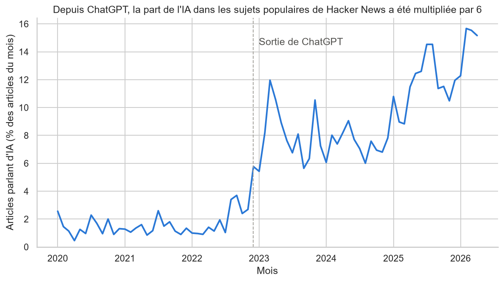
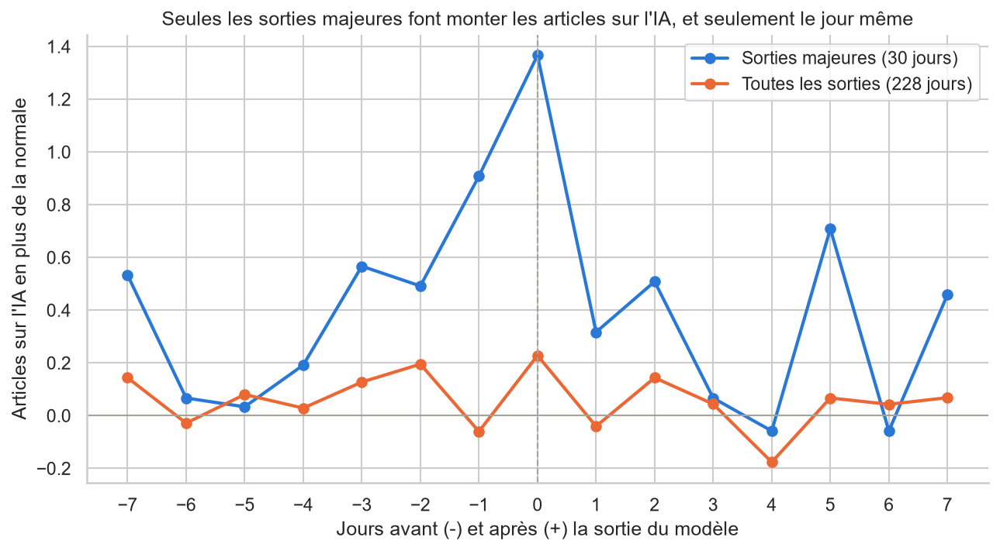
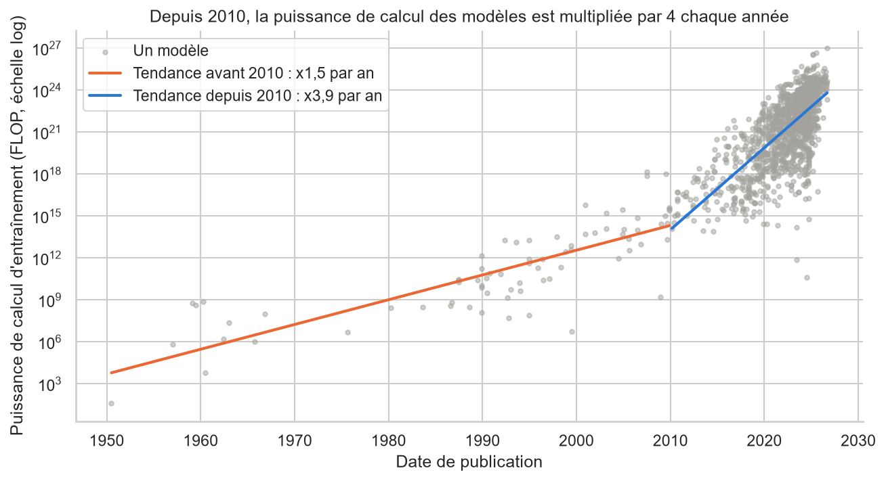

# Hacker News et la vague IA

Quand l'intelligence artificielle a-t-elle envahi les discussions des développeurs, et les sorties de modèles y sont-elles pour quelque chose ?

## Questions étudiées

1. Comment la part de l'IA dans les sujets populaires de Hacker News a-t-elle évolué mois par mois depuis 2020 ? Y a-t-il une cassure à la sortie de ChatGPT (novembre 2022) ?
2. Les articles sur l'IA sont-ils mieux notés et plus commentés que les autres ?
3. Les sorties de modèles des grands labos (OpenAI, Anthropic, Google, Meta) provoquent-elles un pic d'articles dans les jours qui suivent ?
4. Quels labos et quels pays publient le plus de modèles, et la part des modèles à poids ouverts progresse-t-elle ?
5. À quelle vitesse la puissance de calcul des modèles augmente-t-elle d'une année à l'autre ?

## Sources

| Fichier | Source | Licence | Contenu |
|---|---|---|---|
| `data/raw/hacker_news_top_stories_2020_2026.csv` | [Hacker News Top Stories 2020-2026](https://www.kaggle.com/datasets/elvisbui/hacker-news-top-stories-2020-2026), elvisbui, Kaggle | CC BY 4.0 | 100 286 articles ayant dépassé 100 points, du 01/01/2020 au 24/04/2026 |
| `data/raw/ai_models_panel.csv` | [Epoch AI Models Training Compute Panel](https://www.kaggle.com/datasets/kaitoland/epoch-ai-models-training-compute-panel), kaitoland, Kaggle, d'après les données d'[Epoch AI](https://epoch.ai/data) | CC BY 4.0 | 3 626 modèles d'IA, de 1950 à septembre 2026 |

Fichiers téléchargés le 26/10/2026. Les fichiers de `data/raw/` ne sont jamais modifiés : tout passe par le code.

## Installation

```bash
git clone <url-du-depot>
cd projet-analyse
python -m venv .venv
# Windows
.venv\Scripts\activate
# macOS et Linux
source .venv/bin/activate
pip install -r requirements.txt
```

## Ordre d'exécution

1. `notebooks/01_exploration.ipynb` : chargement et inspection des deux jeux
2. `notebooks/02_nettoyage.ipynb` : nettoyage, produit les fichiers de `data/processed/`
3. `notebooks/03_analyse.ipynb` : agrégations, jointure, analyse dans le temps et visualisations

## Principaux résultats

1. **L'IA a envahi Hacker News après ChatGPT.** Sa part dans les articles populaires passe de 1,5 % avant novembre 2022 à 9,4 % après, avec un record de 15,7 % en février 2026.



2. **Les articles sur l'IA font davantage débattre, mais depuis 2024 seulement** : 162 commentaires médians en 2026, contre 113 pour les autres sujets.
3. **Seules les grandes sorties de modèles font réagir Hacker News, et le jour même** : environ un tiers d'articles sur l'IA en plus le jour d'une sortie majeure (GPT-4, Claude 3, Gemini…), aucun effet pour l'ensemble des sorties.



4. **Google domine la production de modèles** (295 depuis 2020, deux fois plus que Meta), et les États-Unis devant la Chine. La part des modèles à poids ouverts a culminé à 60 % en 2023 avant de reculer.
5. **La puissance de calcul des modèles est multipliée par 3,9 chaque année depuis 2010**, contre 1,5 avant : un doublement tous les 6 mois.



## Limites

- Le jeu Hacker News ne contient que les articles ayant dépassé 100 points : c'est une vue des sujets populaires, pas de tout ce qui est publié.
- L'année 2026 s'arrête au 24 avril côté Hacker News.
- Un article « sur l'IA » est repéré par des mots-clés dans son titre, ce qui manque les titres qui n'en parlent qu'indirectement.
